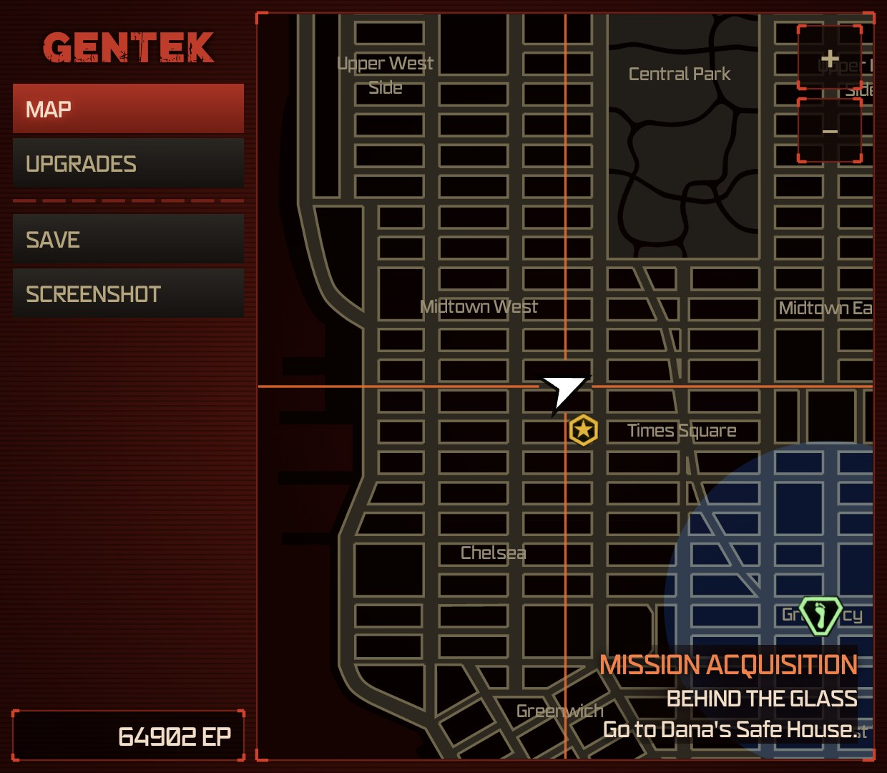
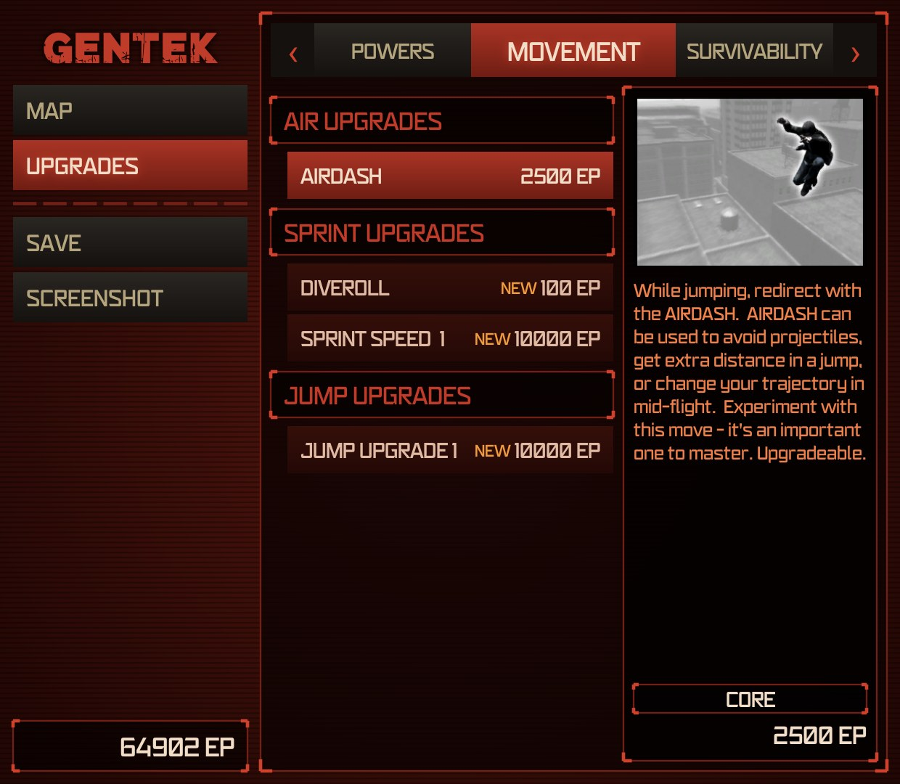

<div align="center">

# Prototype for AYN Thor

**Tap the icon, play Prototype (2009) natively on an Android handheld. No PC, no streaming.**

Unofficial fan project · based on [GameNative](https://github.com/utkarshdalal/GameNative) · GPL-3.0

</div>

---

A single-purpose Android launcher for the PC version of *Prototype*. It runs your own copy of the game through
Wine/Proton, the FEX x86 emulator, DXVK and the Turnip Vulkan driver, all bundled inside the APK, so the first launch
works offline.

It is a trimmed-down fork of [GameNative](https://github.com/utkarshdalal/GameNative): the library, store logins,
downloads and settings are gone, and a fixed configuration that is known to work for Prototype is built in.

> **No game files are included.** You need your own legally purchased copy of Prototype.

## Tested on

| | |
|---|---|
| Device | AYN Thor: Snapdragon 8 Gen 2 (QCS8550), Adreno 740, 12 GB RAM, Android 13 |
| Game | Prototype, PC version (Steam release) |
| Result | Boots to the menu and plays: controller, sound and saves work |
| Performance | Menus 60 FPS; open-world city gameplay ~51–60 FPS (about 56 on average) at 1280×720 |
| First launch | About 3–4 minutes, once, while the runtime is unpacked |
| Later launches | Tap → game in about 10–15 seconds |

Other Snapdragon devices with Adreno 7xx GPUs may work too, but only the AYN Thor has been tested.

## How to use

1. Build the APK (see below) and install it.
2. Put the game folder in a folder named **`prt`** at the root of the internal storage (`/storage/emulated/0/prt`)
   or of an SD card, so that `prt/prototypef.exe` exists. Already downloaded Prototype with
   [GameNative](https://github.com/utkarshdalal/GameNative) to the SD card or external storage? Then it is found where
   it is (`GameNative/Steam/steamapps/common/Prototype` on that volume) and nothing needs moving. A copy in GameNative's
   internal app storage can't be read by other apps; move it to `prt` or reinstall it to the SD card.
3. Tap **Prototype** and allow "All files access" when asked (needed to read the `prt` folder). The first launch sets
   everything up once; after that the icon goes straight into the game.

Saves are kept in `saves` next to the game (`prt/saves`), so they survive reinstalling the app.

**Second screen.** On the AYN Thor the bottom screen shows a companion while you play, drawn like the game's own pause
screens with its map, icons and lettering (read from your game files): a live map that follows Alex with the game's
markers, zones and current objective, the upgrade store, and buttons to save and take a screenshot. It hides
when the game is minimised, and does not run at all on a device without a second screen. Details in [docs/PROTOTYPE.md](docs/PROTOTYPE.md#second-screen-companion).

| Map | Upgrades |
|---|---|
|  |  |

*The AYN Thor's bottom screen while playing; the map, icons, lettering and pictures are read from the game files on the device.*

## Building

Requirements: JDK 17 and the Android SDK (platform 36, build-tools 34.0.0, NDK 27.3.13750724) set in `local.properties`.

```powershell
pwsh tools/Fetch-Bundle.ps1     # downloads the bundled runtime (imagefs, Proton, Turnip) and checks SHA-256
./gradlew :app:assembleLegacyDebug
```

The APK lands in `app/build/outputs/apk/legacy/debug/`. It is about 725 MB because the whole runtime is inside.

## How it works

| Piece | Role |
|---|---|
| [GameNative](https://github.com/utkarshdalal/GameNative) | The Android app, X server, Wine container management and controller support this fork is built on |
| Proton 10 (arm64ec) | Wine for running the Windows game |
| [FEX](https://github.com/FEX-Emu/FEX) | Emulates the game's 32-bit x86 code on ARM64 |
| [DXVK](https://github.com/doitsujin/dxvk) | Translates Direct3D 9 to Vulkan |
| [Mesa Turnip](https://docs.mesa3d.org/drivers/freedreno.html) | Vulkan driver for the Adreno GPU |

Two things were needed to make Prototype run well:

- **A deadlock fix.** The game keeps some internal locks at unaligned memory addresses. x86 CPUs handle that, but
  ARM64 can't do it atomically and both x86 emulators (FEX and Box64) corrupt the lock, so the game hangs on a black
  screen. FEX's `FEX_STRICTINPROCESSSPLITLOCKS=1` mode fixes it.
- **A faster emulator preset.** FEX's INTERMEDIATE preset roughly doubled city FPS compared with the strictest
  preset (about 56 vs 32), with no visible physics problems.

Technical details and on-device tuning: [docs/PROTOTYPE.md](docs/PROTOTYPE.md).

## Credits

- **[GameNative](https://github.com/utkarshdalal/GameNative)** by Utkarsh Dalal and contributors. This project would
  not exist without it. To play other games on Android, use GameNative itself, and consider
  [supporting it](https://ko-fi.com/gamenative).
- GameNative builds on [Winlator](https://github.com/brunodev85/winlator) and [Pluvia](https://github.com/oxters168/Pluvia).
- [Wine](https://www.winehq.org/), [Proton](https://github.com/ValveSoftware/Proton), [FEX](https://github.com/FEX-Emu/FEX),
  [DXVK](https://github.com/doitsujin/dxvk), [Mesa](https://www.mesa3d.org/) and every other open-source component
  listed in [THIRD_PARTY_NOTICES](THIRD_PARTY_NOTICES).

## License

GPL-3.0, like GameNative. See [LICENSE](LICENSE) and [THIRD_PARTY_NOTICES](THIRD_PARTY_NOTICES).

GameNative's closed-source components (`libredirect`, `libsteambootstrap`, `libkgslshim`) are **not** part of this
repository or of the APK built from it; Prototype runs without them.

## Trademarks and disclaimer

*Prototype* is a trademark of Activision Publishing, Inc.; the game was developed by Radical Entertainment. Steam is a
trademark of Valve Corporation. AYN and AYN Thor are trademarks of their respective owner. All other trademarks belong
to their respective owners.

This is an unofficial, non-commercial fan project. It is not affiliated with, endorsed by or sponsored by Activision,
Radical Entertainment, Valve, AYN or the GameNative project. It contains no game files, code or assets from
*Prototype* (the companion screenshots in `docs/images` show game art read from a player's own copy); you must own
a legal copy of the game. The software is provided "as is", without warranty of any kind.
